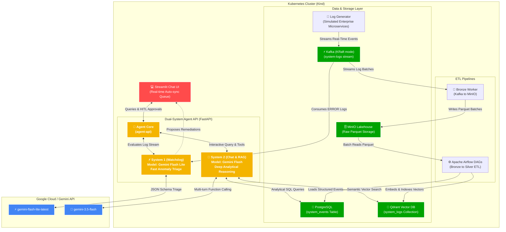

# Dual-System Agents: Architecture Summary & Interview Playbook

This document contains the complete architectural master summary, technology breakdown, pre-interview verification checklist, and live demo runbook.

---

# Part 1: Architecture Master Summary

## Core Value Proposition
This project implements **Daniel Kahneman's Dual-System Cognitive Model** applied to Cloud Observability & AIOps:
* **System 1 (Reactive Triage):** Fast, low-latency, subconscious-like anomaly detection running continuously over high-throughput telemetry streams.
* **System 2 (Analytical Reasoning):** Deliberate, deep, conversational agent equipped with database querying and semantic vector search tools to investigate root causes and advise human operators.

---

## Architecture Diagram



---

## Cluster Namespaces & Isolation Strategy

The cluster is intentionally divided into two logical namespaces:
* **`streaming`:** Houses real-time high-throughput message ingestion (`kafka-0`, `log-generator`).
* **`lakehouse`:** Houses the analytical data platform and AI services (`postgres-0`, `minio-0`, `airflow`, `qdrant-0`, `agent-api`, `chat-ui`).

### Why this design matters in an interview:
1. **Production-Grade Separation of Concerns:** Isolates volatile, high-throughput log traffic from stateful databases and analytical services.
2. **Explicit Cross-Namespace DNS Routing:** Demonstrates microservices networking across namespaces using standard Kubernetes FQDNs (e.g., `kafka.streaming.svc.cluster.local:9092`).
3. **Least-Privilege RBAC Security:** The `agent-api` pod runs with a dedicated `ServiceAccount` and `ClusterRoleBinding` that restricts remediation patching permissions specifically to target deployments in the `streaming` namespace.

---

## Component Breakdown

### 1. Ingestion & Streaming Layer (`streaming` namespace)
* **`log-generator` ([producer.py](file:///home/maayan/Documents/dual-system-agents/services/log_generator/producer.py)):** 
  Simulates a real-world e-commerce microservices mesh (`auth-service`, `payment-service`, `order-service`, `inventory-service`, `recommendation-engine`). It continuously emits realistic HTTP latencies, status codes, and injected failure modes (Stripe timeouts, DB deadlocks, circuit-breaker trips).
* **`kafka-0` (Apache Kafka 3.7):** 
  High-performance event streaming platform deployed in **KRaft mode** (no ZooKeeper needed). JVM heap is bounded to `384 MB` for optimal laptop efficiency.

### 2. Lakehouse & Storage Layer (`lakehouse` namespace - Medallion Architecture)
* **`bronze-worker` ([bronze_worker.py](file:///home/maayan/Documents/dual-system-agents/services/bronze_worker/bronze_worker.py)):** 
  Consumes raw events from Kafka and flushes them as partitioned **Apache Parquet** files into MinIO (Bronze raw layer).
* **`minio-0`:** 
  S3-compatible object storage serving as the cluster's raw telemetry data lake.
* **`airflow` (Apache Airflow 2.9 Standalone):** 
  Orchestrates the `bronze_to_silver_etl` DAG: parses Parquet files from MinIO, structures events into PostgreSQL, and vectorizes log texts into Qdrant.
* **`postgres-0` (PostgreSQL 16):** 
  Stores the structured `system_events` table (timestamps, services, status codes, response times, error messages) used for analytical SQL querying.
* **`qdrant-0`:** 
  Vector database storing dense embeddings (`bge-small-en-v1.5`) for semantic similarity search over log texts.

### 3. Dual-System AI Engine (`lakehouse` namespace)
* **`agent-api` ([main.py](file:///home/maayan/Documents/dual-system-agents/services/agent_api/main.py)):**
  FastAPI service hosting both cognitive systems:
  * **System 1 (Watchdog):** Background Kafka consumer listening for `level == "ERROR"`. Calls `gemini-flash-lite-latest` using strict Pydantic JSON schemas to triage the failure and propose a Kubernetes deployment restart into an in-memory approval queue.
  * **System 2 (Analytical Agent):** Conversational agent powered by `gemini-3.5-flash`. Uses Google GenAI's **Automatic Function Calling (AFC)** with two live tools:
    * `execute_sql`: Runs ad-hoc analytical SQL queries against PostgreSQL.
    * `search_logs`: Runs vector similarity searches against Qdrant.
  * **Kubernetes Remediation:** When an action is approved, `agent-api` uses the official Kubernetes Python API to patch the deployment's annotations (`kubectl.kubernetes.io/restartedAt`), triggering a rolling pod restart.

### 4. Frontend & Human-In-The-Loop (HITL)
* **`chat-ui` ([chat_ui.py](file:///home/maayan/Documents/dual-system-agents/ui/chat_ui.py)):**
  Streamlit interface featuring:
  * **Main Chat:** Conversational workspace with System 2 for deep log investigations.
  * **Live Watchdog Sidebar:** Real-time auto-syncing queue using `@st.fragment(run_every=4)` that displays incoming System 1 recommendations with Approve / Reject buttons.
  * **Collapsible Remediation History:** Timestamped audit log of all human approvals/rejections kept tucked away in the sidebar to prevent chat clutter.

### 5. Execution Pipeline: Who Physically Runs the YAMLs?

A common interview question: *"What is the chain of execution from a YAML file to a running container?"*

```
deploy.sh  ──▶  kubectl apply  ──(HTTP/REST)──▶  kube-apiserver  ──▶  etcd (Store Desired State)
                                                        │
                                                        ▼
                                             Kube Controller & Scheduler
                                                        │
                                                        ▼ (Assign to node)
                                               kubelet (Node Agent)
                                                        │
                                                        ▼ (CRI: Container Runtime Interface)
                                              containerd (Spins up containers)
```

1. **`deploy.sh`:** Automation bash wrapper that verifies prerequisites, injects secrets, loads local images into Kind, and triggers `kubectl apply -f k8s/`.
2. **`kubectl`:** The CLI client that converts declarative YAML manifests into structured JSON payloads and sends them to the Kubernetes API over HTTPS.
3. **`kube-apiserver` (Control Plane):** Validates and writes the cluster's desired state into **`etcd`** (the cluster's single source of truth).
4. **`kube-scheduler` & Controllers:** Detect the new desired state, resolve dependencies, and assign pods to nodes.
5. **`kubelet` & `containerd`:** The node's worker agent (`kubelet`) receives the pod specification and commands the container runtime (`containerd` inside the Kind node) to physically unpack the image, isolate cgroups/namespaces, and run the container processes.

---

# Part 2: Pre-Interview Checklist & Live Demo Runbook

## Phase A: Pre-Interview Preparation (1–2 Hours Before)

- [ ] **1. Docker & Environment Verification**:
  Ensure Docker service is running and `.env` has your API key:
  ```bash
  cat .env # verify GEMINI_API_KEY is present
  sg docker -c "docker ps" # verify no permission issues
  ```

- [ ] **2. Pre-Warm the Cluster**:
  Pre-warm everything in advance so images are cached and pods are already `Running`:
  ```bash
  ./deploy.sh
  ```

- [ ] **3. בדיקות חיוניות (Essential Health Checks)**:
  Run these three checks to verify data and pods are healthy:
  ```bash
  # Check 1: All 10 pods must show 1/1 Running
  sg docker -c "kubectl get pods -A"

  # Check 2: Verify PostgreSQL system_events table has populated events
  sg docker -c "kubectl exec statefulset/postgres -n lakehouse -- psql -U agent -d analytical_db -c 'SELECT count(*) FROM system_events;'"

  # Check 3: Verify Qdrant system_logs collection has indexed points
  sg docker -c "kubectl exec deployment/agent-api -n lakehouse -- /opt/venv/bin/python -c \"from qdrant_client import QdrantClient; qc = QdrantClient(url='http://qdrant.lakehouse.svc.cluster.local:6333'); print('Points:', qc.count('system_logs'))\""
  ```

  > [!TIP] **Troubleshooting: `ERROR: relation "system_events" does not exist`**
  > The `system_events` table is **not** created by static SQL migrations. It is created dynamically by Pandas inside Airflow's `bronze_to_silver_etl` DAG (`df.to_sql("system_events")`) once `bronze-worker` writes the first batch of 50 logs to MinIO.
  > If Check 2 throws this error on a newly deployed cluster, unpause and trigger Airflow manually:
  > ```bash
  > sg docker -c "kubectl exec deployment/airflow -n lakehouse -- airflow dags unpause bronze_to_silver_etl"
  > sg docker -c "kubectl exec deployment/airflow -n lakehouse -- airflow dags trigger bronze_to_silver_etl"
  > ```
  > Wait ~10–15 seconds for the DAG run to finish, then re-run Check 2. (Once triggered, it runs automatically every 5 minutes).

- [ ] **4. Open Port-Forwards**:
  In a separate terminal tab, start the UI port-forward:
  ```bash
  kubectl port-forward svc/chat-ui -n lakehouse 8501:8501
  ```
  *(Optional: If you plan to showcase the Airflow DAG or MinIO buckets)*:
  ```bash
  kubectl port-forward svc/airflow-webserver -n lakehouse 8080:8080
  kubectl port-forward svc/minio -n lakehouse 9001:9001
  ```

- [ ] **5. Browser Setup**:
  Open `http://localhost:8501` in your browser. Click **"🧹 Clear Chat History"** in the sidebar to start with a pristine conversation.

---

## Phase B: Live Demo Script (Step-by-Step for the Interview)

### Step 1: The Elevator Pitch (30 seconds)
> *"This project solves a critical problem in microservices observability: alert fatigue and manual incident triage. I designed a Dual-System AI architecture running natively inside Kubernetes.*
> 
> *System 1 is an ultra-fast watchdog that detects stream anomalies in sub-seconds and queues remediation recommendations for human approval. System 2 is an analytical reasoning agent that can autonomously query SQL and vector databases to explain incidents."*

### Step 2: Show System 1 in Action (The Watchdog Queue)
1. Point to the **left sidebar** on [http://localhost:8501](http://localhost:8501).
2. Highlight how the queue auto-syncs in **real time**:
   > *"Under the hood, Kafka is streaming live microservice logs. Whenever an ERROR occurs, System 1 evaluates the incident using Gemini Flash Lite with structured JSON schemas and proposes an action."*
3. Expand one of the alerts (e.g., `Restart: payment-service` or `order-service`).
4. Click **"✅ Approve"**.
5. Show the corner toast alert:
   > *"Notice the Human-In-The-Loop paradigm: the agent doesn't reboot blindly. It asks the engineer. Once approved, `agent-api` uses the Kubernetes API to patch the deployment and execute a rolling restart."*
6. Expand **"📜 Remediation History"** in the sidebar to show the clean audit log.

### Step 3: Show System 2 in Action (Deep Chat & Function Calling)
1. In the main chat, type:
   ```text
   What were the latest errors across the cluster in the last 10 minutes?
   ```
2. Point out the sub-second response:
   > *"Notice how System 2 autonomously decided to call `execute_sql` on PostgreSQL to group events, calculate response times, and identify the root cause."*
3. Ask a follow-up analytical question:
   ```text
   Which service had the highest failure rate, and what were the most common error messages?
   ```
4. Show how it parses complex database records into an executive markdown summary.

### Step 4: Show the Data Engineering Depth (If asked about infrastructure)
* Open **Airflow** (`http://localhost:8080`, `admin` / `2Ea83BgTCahBAKm6`) to show the DAG moving data from Bronze Parquet to Silver SQL/Vector.
* Open **MinIO** (`http://localhost:9001`, `minioadmin` / `minioadmin`) to show raw Parquet batch partitions.

### Step 5: The "Engineering Efficiency" Talking Point
If asked about hardware, costs, or scalability:
> *"By offloading heavy LLM inference to Gemini API rather than running heavy 7B models locally on CPU, the entire Kubernetes cluster—including Kafka, Airflow, MinIO, PostgreSQL, Qdrant, and all microservices—runs under **2.5 GB of RAM** with zero GPU requirements, running quietly on a standard laptop."*

---

## Phase C: Teardown (After the Interview)
When the demo is over and you want to shut down all cluster resources:
```bash
./teardown.sh
```
This cleanly removes the Kind cluster and returns 100% of your RAM and CPU back to your machine.

