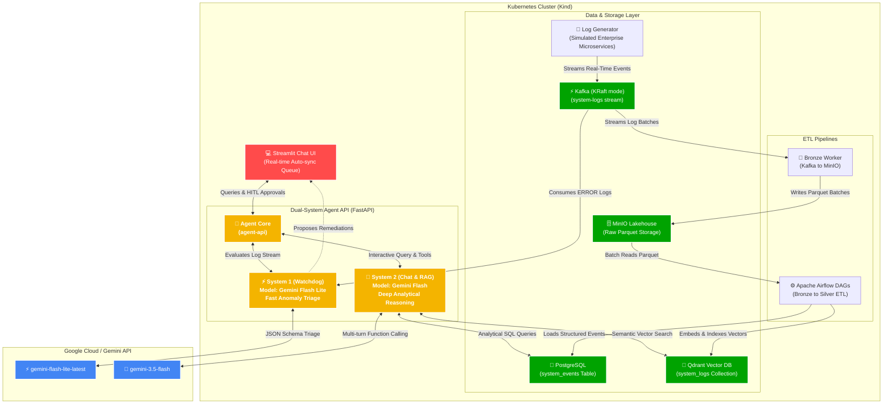

# Dual-System Agents

A Dual-System cognitive agent architecture for Kubernetes cluster observability and autonomous remediation:
* **System 1 (Watchdog):** Fast, low-latency agent (`gemini-flash-lite-latest`) continuously monitoring real-time Kafka log streams. It identifies critical anomalies, triages incidents, and proposes remediation actions into a Human-In-The-Loop (HITL) approval queue.
* **System 2 (Chat & RAG):** Deep analytical agent (`gemini-3.5-flash`) powering an interactive chat UI. It uses multi-turn automatic function calling to query structured telemetry via PostgreSQL and perform semantic search across unstructured logs via Qdrant.

---

## Architecture



---

## Key Features

* **Event-Driven Streaming:** High-throughput log streaming using Apache Kafka in KRaft mode (no ZooKeeper dependency).
* **Medallion Data Lakehouse:**
  * **Bronze Layer:** `bronze-worker` ingests raw Kafka streams into MinIO S3 object storage as Parquet batches.
  * **Silver Layer:** Apache Airflow DAG (`bronze_to_silver_etl`) parses raw Parquet files, populates PostgreSQL for analytical SQL queries, and embeds logs into Qdrant for vector search.
* **Dual-System Cognitive AI:**
  * **System 1:** Low-latency triage using structured JSON outputs to propose pod restarts and remediation plans.
  * **System 2:** Analytical conversational agent using native function calling (`execute_sql`, `search_logs`).
* **Human-In-The-Loop (HITL) Dashboard:** Live auto-syncing queue with one-click approval/rejection and full remediation audit logging.
* **Lightweight Local Footprint:** Optimized single-node Kind cluster running under ~2.5 GB RAM total, with zero local GPU requirements.

---

## Microservices & Components

| Component | Technology | Description |
| :--- | :--- | :--- |
| **`log-generator`** | Python / Faker | Simulates enterprise microservices (`auth`, `payment`, `order`, `inventory`, `recommendation`) and injects realistic error scenarios into Kafka. |
| **`kafka`** | Apache Kafka 3.7 (KRaft) | Event broker streaming logs across the `streaming` namespace. |
| **`bronze-worker`** | Python / PyArrow / Boto3 | Batches Kafka log events into Parquet objects on MinIO. |
| **`minio`** | MinIO S3 Lakehouse | High-performance object storage for raw telemetry data. |
| **`postgres`** | PostgreSQL 16 | Structured analytical relational database storing `system_events`. |
| **`qdrant`** | Qdrant Vector DB | Vector database embedding log messages for semantic similarity search. |
| **`airflow`** | Apache Airflow 2.9 | Standalone scheduler executing the automated bronze-to-silver ETL pipeline. |
| **`agent-api`** | FastAPI / Google GenAI | Backend hosting the System 1 watchdog consumer and System 2 chat endpoints. |
| **`chat-ui`** | Streamlit | Chat interface with real-time HITL queue and remediation history. |

---

## Setup & Deployment Instructions

### Prerequisites
- Docker Engine & Docker Compose
- `kubectl`
- `kind`
- A free Gemini API key from [Google AI Studio](https://aistudio.google.com/)

### 1. Configure Environment
Create a `.env` file in the root directory:
```bash
echo "GEMINI_API_KEY=your_gemini_api_key_here" > .env
```
*(The `.env` file is protected by `.gitignore` and is loaded securely into the cluster via Kubernetes Secrets).*

### 2. Deploy Cluster
Run the automated deployment script:
```bash
./deploy.sh
```
This script will:
1. Verify system prerequisites and Docker group permissions.
2. Spin up the single-node Kind cluster (`my-cluster`).
3. Create the `streaming` and `lakehouse` namespaces.
4. Inject your `GEMINI_API_KEY` into Kubernetes Secret `gemini-secret`.
5. Build all custom container images with isolated Python virtual environments (`/opt/venv`).
6. Deploy all workloads and data storage pods in sequence.

---

## Accessing Services & Port-Forwarding

Open terminal tabs to forward the following services:

| Service | Port Forward Command | URL | Credentials |
| :--- | :--- | :--- | :--- |
| **Streamlit Chat UI** | `kubectl port-forward svc/chat-ui -n lakehouse 8501:8501` | [http://localhost:8501](http://localhost:8501) | — |
| **Agent API Docs** | `kubectl port-forward svc/agent-api -n lakehouse 8000:8000` | [http://localhost:8000/docs](http://localhost:8000/docs) | — |
| **Airflow Webserver** | `kubectl port-forward svc/airflow-webserver -n lakehouse 8080:8080` | [http://localhost:8080](http://localhost:8080) | `admin` / `2Ea83BgTCahBAKm6` |
| **MinIO Console** | `kubectl port-forward svc/minio -n lakehouse 9001:9001` | [http://localhost:9001](http://localhost:9001) | `minioadmin` / `minioadmin` |

---

## Teardown

To shut down the cluster and immediately reclaim all memory and disk space:
```bash
./teardown.sh
```
