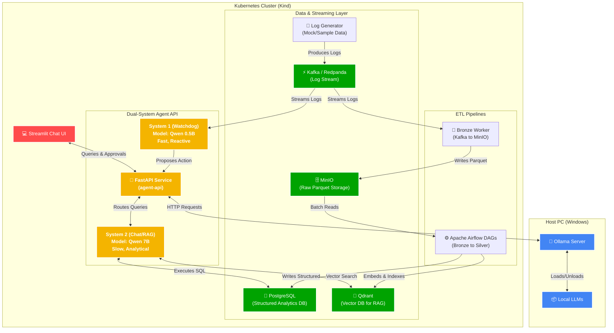

# Dual-System Agents

A Dual-System cognitive agent architecture for cluster observability: **System 1** provides fast anomaly detection over real-time log streams, while **System 2** handles deep log retrieval, analytical SQL querying, and guided cluster remediation.

## Architecture



*   **System 1 (Watchdog):** A fast, low-latency agent (`gemini-flash-lite-latest`) continuously monitoring Kafka event streams (e.g., system logs). It identifies anomalies and proposes remediation actions, adding them to a Human-In-The-Loop (HITL) approval queue.
*   **System 2 (Chat/RAG):** An analytical agent (`gemini-3.8-flash`) handling the interactive Streamlit UI. It answers complex user queries using Retrieval-Augmented Generation (RAG) against system logs and SQL analytics, and executes remediation actions when instructed or when HITL approvals are granted.

## Features

*   **Kafka Event Streaming:** Simulates a real-time log stream using KRaft mode.
*   **Vector Database (Qdrant):** Embeds and stores logs for semantic RAG search.
*   **Analytical Storage (PostgreSQL & MinIO):** Structured analytical database and raw Parquet lakehouse storage with Airflow ETL.
*   **Human-In-The-Loop (HITL):** Proposed actions by System 1 require user approval before execution.
*   **Kubernetes (Kind):** Microservices orchestrated across `streaming` and `lakehouse` namespaces.
*   **Gemini API Models:** Fast, intelligent reasoning with zero local model memory footprint.

## Components

1.  `kafka-producer`: Generates mock system logs and anomalies.
2.  `qdrant`: Vector database for RAG.
3.  `agent-api`: FastAPI backend hosting the Dual-System agents.
    *   Watchdog task (System 1) consuming Kafka.
    *   REST endpoints (System 2) for chat and approvals.
4.  `chat-ui`: Streamlit frontend for interacting with the system.

## Setup Instructions

1.  **Prerequisites:** Docker, Kind, `kubectl`.
2.  **Configure API Key:**
    Create a `.env` file in the project root:
    ```bash
    echo "GEMINI_API_KEY=your_gemini_api_key" > .env
    ```
3.  **Deploy Cluster:**
    ```bash
    ./deploy.sh
    ```
4.  **Access Services:**
    - Streamlit Chat & HITL UI: `kubectl port-forward svc/chat-ui -n lakehouse 8501:8501` -> [http://localhost:8501](http://localhost:8501)
    - Agent API: `kubectl port-forward svc/agent-api -n lakehouse 8000:8000` -> [http://localhost:8000/docs](http://localhost:8000/docs)
    - Airflow Webserver: `kubectl port-forward svc/airflow-webserver -n lakehouse 8080:8080` -> [http://localhost:8080](http://localhost:8080)
5.  **Teardown:**
    ```bash
    ./teardown.sh
    ```

